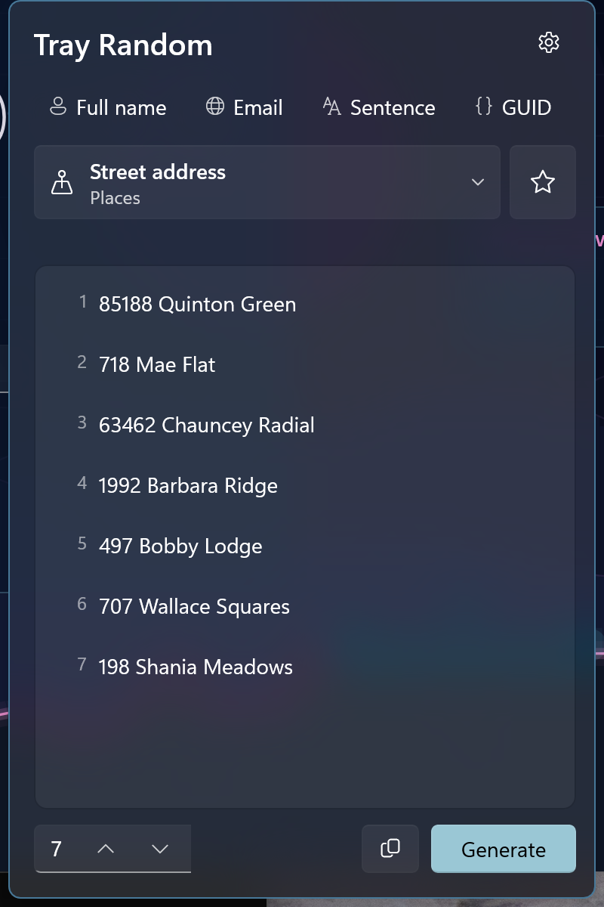

# Tray Random

Dice, names, emails, addresses, lorem ipsum, GUIDs and more, one click away in the Windows notification area.



Tray Random is a small tray-only app. Click its dice icon to open a flyout, pick what you need, and copy the result. Your most-used categories stay pinned along the top, so switching between "a d20", "a full name" and "a test email" is a single click. Fake data comes from [Bogus](https://github.com/bchavez/Bogus), so it looks realistic and can follow 50 languages and regions.

## What it does

- **77 categories in 10 groups:**
  - **Dice & chance:** dice roll, coin flip, number in range, pick from list, shuffle list, yes or no, playing card
  - **People:** full, first and last name, username, job title, phone number, a full person profile
  - **Text:** word, words, sentence, paragraph, slug, hacker phrase, catch phrase, business buzzwords, product review
  - **Internet:** email, URL, domain, IPv4, IPv6, MAC, port, password, user agent, hex color
  - **Places:** full address, street, city, state or region, postal code, country, country code, coordinates, time zone
  - **Business:** company, product, department, price, EAN-13 barcode
  - **Finance:** credit card number, CVV, IBAN, BIC/SWIFT, account number, routing number, amount, currency, Bitcoin and Ethereum addresses
  - **Dates & times:** past date, future date, birthday (with age), time of day, ISO timestamp, weekday, month
  - **Tech & IDs:** GUID, hex string, random string, SHA-1 hash, version number, file name, file path, MIME type, database column
  - **Fun & misc:** color name, vehicle, VIN, music genre
- **Dice notation:** `d20`, `2d6+3`, `4d6kh3` (keep the highest 3), `2d20kl1` (disadvantage), `d%`, and mixed terms like `2d6-d4+1`. Quick buttons for d4 to d100 keep your dice count (3d6 becomes 3d20). Results show the working, with dropped dice in parentheses: `4d6kh3: [6, 5, 3, (1)]`.
- **Animated dice:** the eye button next to "how many" turns on a dice tray. The tray shows one roll, so turning it on sets the count to 1 and raising the count turns it off. Each roll throws real-looking dice (a triangle d4, pipped d6, kite d10, a d20 with its facets, and so on) that tumble, bounce and settle before the total springs in. Dropped dice dim, subtracted dice are orange, and a top roll flashes gold. Click the tray to roll again. It respects Windows "Animation effects" (off means the dice just appear) and steps aside in High Contrast. It draws up to 24 dice and counts the rest.
- **Several at once:** set "how many" (no upper limit) to get a numbered list. Click any line to copy just that one, or use Copy to take them all. Picking from a list draws without repeats until the list runs out, like names from a hat.
- **Favorites:** star any category to pin it in the strip at the top. Drag chips to reorder them, or right-click a chip to move it left or right, or unpin it. Five are pinned to start (dice, full name, email, sentence, GUID).
- **Tray menu:** right-click the icon for "Copy full name", "Copy email" and so on for your first six favorites. Each one generates a fresh value and copies it without opening the flyout, and the tooltip shows what was copied.
- **Keyboard:**

  | Keys | Action |
  |---|---|
  | Enter, Space (Generate focused), Ctrl+R, F5 | Generate again |
  | Ctrl+1 to Ctrl+9 | Switch to that favorite |
  | Ctrl+Tab / Ctrl+Shift+Tab | Next / previous favorite |
  | Ctrl+D | Add or remove the current category from favorites |
  | Ctrl+Shift+C | Copy the results |
  | Esc | Back out of settings, then close the flyout |

- **Settings** (gear button or the tray menu): language and region for generated data, copy each result automatically, reset favorites, and start with Windows.

Your category, inputs (dice, range, list) and count are remembered between sessions.

## Install

Download the latest MSIX for your architecture (x64 or ARM64) from [GitHub Releases](../../releases). Release packages are signed with the publisher's certificate. If Windows says it can't verify the publisher, install the certificate from the release first, or build from source.

Requires Windows 10 version 1809 or later, or Windows 11, on x64 or ARM64.

## Setup

None. There are no accounts and no API keys.

## Privacy and footprint

- **No network access.** The package doesn't declare the internet capability. Everything is generated on your PC.
- **The values are fake.** Credit card numbers, IBANs and the rest have the right shape (and a valid checksum where Bogus provides one), but they aren't real accounts. Use them for testing and mockups, and not as real passwords or secrets: they come from an ordinary pseudo-random generator, not a cryptographic one.
- Settings, favorites and your last inputs are stored in the app's local settings. Nothing is saved anywhere else.
- When it's idle, the app is a tray icon and little else. The flyout closes for real a minute after you dismiss it, and its memory goes back to Windows.

## Build from source

Prerequisites: the .NET 10 SDK and the winapp CLI (`winget install Microsoft.WinAppCli`).

```powershell
cd TrayRandom
winapp run             # build, register, and launch with package identity
winapp run --clean     # start fresh to see first run again
cd ..
dotnet test TrayRandom.Tests   # dice notation, dice tray layout, favorites, and every category in every locale
```

The solution has three projects:

| Project | What's in it |
|---|---|
| `TrayRandom` | The WinUI 3 tray app: tray icon, flyout, settings page |
| `TrayRandom.Core` | No Windows dependencies: the category catalog (Bogus), dice notation parser and roller, dice tray layout and throw paths, favorites logic, locales |
| `TrayRandom.Tests` | MSTest tests for Core |

To make a release, bump the version in `TrayRandom/Package.appxmanifest` and run `build-msix-for-gh.ps1`. It builds signed x64 and ARM64 MSIX packages and drafts a GitHub release.

## License

MIT, see [LICENSE](LICENSE). Fake data by [Bogus](https://github.com/bchavez/Bogus) (MIT).
